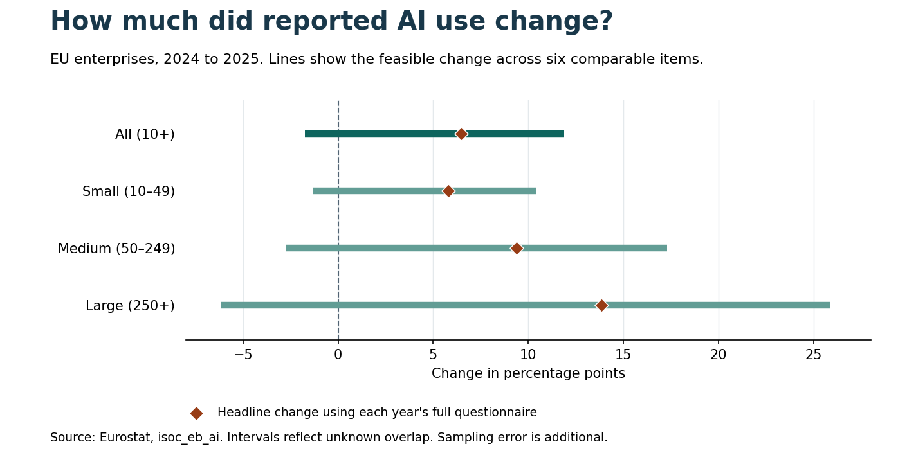

# How much of Europe's reported AI growth can we compare across years?

**A research editor can report that EU enterprise AI use rose from 13.48% in 2024 to 19.95% in 2025 under each year's questionnaire.** An example of directly comparable growth is text mining, which rose from **6.88% to 11.75%**. Eurostat added a question on generating media and expanded another to mention programming code. The published totals alone leave open how many distinct enterprises used at least one of the six comparable technologies. [Eurostat data](https://doi.org/10.2908/ISOC_EB_AI) · [Questionnaire changes, p. 13](https://ec.europa.eu/eurostat/documents/7870049/23260410/KS-01-26-009-EN-N.pdf)

**How much does the distinction matter?** The reported headline grew **6.47 percentage points**. Across the six comparable categories, the narrowest range supported by the selected published figures runs from **a 1.74-point decline to an 11.895-point increase**. Both ends can be achieved by patterns of overlapping use consistent with the data and its rounding. The same enterprise may use text mining, speech recognition and machine learning. Adding those shares counts some enterprises more than once.



| EU enterprise group | Headline change (points) | Feasible change across six comparable items (points) |
| --- | ---: | ---: |
| All, 10+ persons employed | +6.47 | −1.740 to +11.895 |
| Small, 10–49 | +5.79 | −1.350 to +10.385 |
| Medium, 50–249 | +9.39 | −2.760 to +17.285 |
| Large, 250+ | +13.86 | −6.140 to +25.840 |

The endpoint precision records the half-unit rounding allowance. Sampling uncertainty would be additional. The EU-wide row uses Eurostat's published aggregate. [Annual ranges](results/intervals.csv) · [Change calculations](results/changes.csv)

## What a research lead should publish or commission

- **For an immediate briefing**, publish the official headline with its questionnaire change, then use a comparable item for a concrete example. The share reporting text mining rose **4.87 points**. This measures reported tool use. Productivity, hours worked and jobs displaced require separate outcomes.
- **For a stable adoption series**, request one weighted tabulation for each year and enterprise size group: the share answering yes to **any of the same six items**, with its design-based standard error. More item totals leave the overlap ambiguous. The published counts of enterprises using two or three technologies do tighten the upper change bound for large firms by **4.675 points**. They leave the EU-wide range unchanged.
- **To estimate the effect of changing the questionnaire itself**, give random subsets of the same survey population the old and new wording in the same field period. The historical bounds establish what the existing figures permit. They cannot assign a share of actual growth to questionnaire wording.

## Reproduce the results

From the repository root with Python 3.11:

```sh
python -m pip install -r requirements.txt
python analyze.py
python verify.py
python figure.py
```

The analysis runs offline. The independent checker uses the archived survey response and verifies a feasible distribution and a mathematical optimality bound for each of 32 endpoints. [Method, source and scope](METHODS.md) · [84 public source figures](results/source_cells.csv) · [Check the certificates](verify.py)

Independent portfolio analysis prepared with AI assistance. Eurostat publishes the underlying survey statistics.
